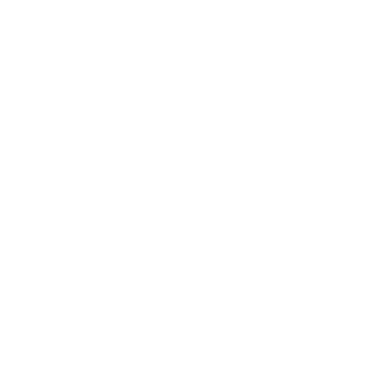

  

    ⚠️ This project has been abandoned. ⚠️
  

  
  <h3>Solipr</h3>
  
A Rust-based Peer to Peer Version Control System.

---

## Status

Solipr has been discontinued.

After further exploration and development, it's clear that [Jujutsu](https://github.com/jj-vcs/jj) already fulfills the core goals Solipr aimed to achieve, and does so exceptionally well. Rather than reinventing the wheel, future work will focus on building tools and extensions on top of Jujutsu instead of creating a new system from scratch.

Thank you for your interest and support!

## Our team

**Founders**

- [Tipragot](https://github.com/tipragot)
- [CoCoSol](https://cocosol.dev) (has left since 2025)
